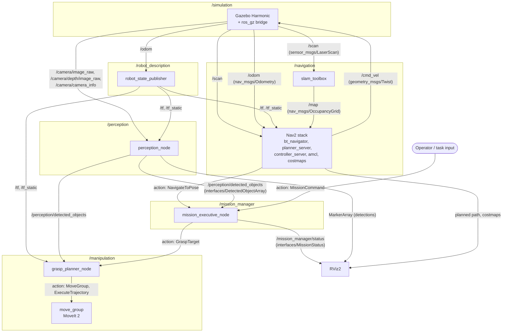

# System Architecture

This document is the Phase 0 deliverable: every node, and every topic/service/action connecting them, decided before implementation. It will be kept in sync with the as-built system (see Phase 9), but this version reflects the Phase 0 design.

## Node graph

## Design rationale: topics vs. services vs. actions

- **Topics** for continuous sensor/state streams with no request/response semantics and no caller waiting on completion: `/scan`, `/odom`, `/tf`, `/camera/*`, `/perception/detected_objects`, `/mission_manager/status`.
- **Actions** for anything long-running and preemptible, where the caller needs feedback and the ability to cancel: `NavigateToPose` (Nav2-provided), `GraspTarget`, `MissionCommand`. Navigating across a room or executing a grasp sequence can take seconds to tens of seconds, can fail partway, and a caller may need to abort — a service call would block with no feedback and no cancellation, which is wrong for this shape of work.
- **No custom services** are currently planned. The candidates considered (e.g. "get current detections on demand") are better served by topics (detections are already published continuously) or actions (anything that takes meaningful time). If a clear request/response-with-immediate-answer need shows up later (e.g. "is the arm currently holding an object"), a service is the right tool then — the point isn't to avoid services, it's that nothing in the current design fits their profile yet.

## Custom interfaces (defined in `/interfaces`)

| Interface | Type | Used by |
|---|---|---|
| `DetectedObject.msg` | message | one detected object: class, pose, confidence |
| `DetectedObjectArray.msg` | message | wraps `DetectedObject[]`, published per perception cycle |
| `MissionStatus.msg` | message | mission executive's current state, published continuously |
| `GraspTarget.action` | action | mission executive commands grasp_planner_node to grasp + transport an object |
| `MissionCommand.action` | action | operator commands the mission executive with a high-level task |

Full field-level definitions live in `/interfaces` itself (the interface files are the source of truth; this table is an index, not a duplicate spec).

## Package -> node mapping

| Package | Build type | Node(s) |
|---|---|---|
| `robot_description` | ament_cmake | none (URDF/Xacro/meshes only; `robot_state_publisher` is a stock ROS 2 node launched with this package's URDF) |
| `simulation` | ament_cmake | none (Gazebo worlds + `ros_gz` bridge config + top-level bringup launch file) |
| `navigation` | ament_cmake | none yet (Phase 3 adds SLAM/Nav2 launch + param files; both are stock packages, not custom nodes) |
| `perception` | ament_python | `perception_node` |
| `manipulation` | ament_python | `grasp_planner_node` (custom); `move_group` is a stock MoveIt 2 node configured, not written, by this package |
| `mission_manager` | ament_python | `mission_executive_node` |
| `interfaces` | ament_cmake | none (message/action definitions only) |
| `tests` | ament_python | integration + fault-injection test scripts (Phase 7/8) |

## Why the top-level launch file lives in `/simulation`

Phase 0 asks for one command that starts every subsystem end-to-end. That launch file (`simulation/launch/bringup.launch.py`) is a *process orchestrator* (starts nodes as OS processes) and is deliberately kept separate from `mission_executive_node`, which is a *behavioral orchestrator* (sequences already-running nodes through a mission via their action interfaces at runtime). Putting the bringup launch file in `/simulation` — the package already responsible for standing up the simulated world — avoids inventing a tenth top-level package for a project whose repo structure is intentionally fixed in Phase 0.
